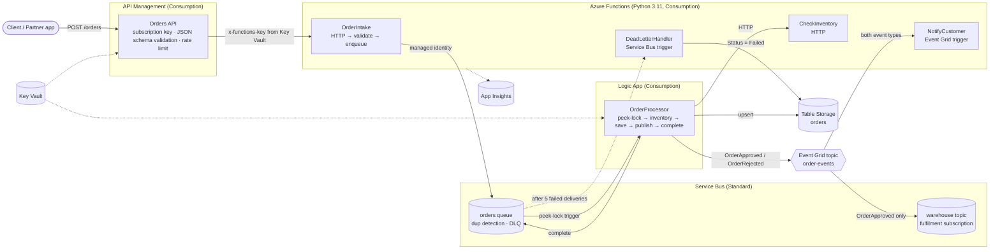

# OrderFlow — Order Processing on Azure Integration Services

[](https://github.com/chathura-dandeniya/azure-orderflow-integration/actions/workflows/deploy.yml)
[](https://github.com/chathura-dandeniya/azure-orderflow-integration/actions/workflows/terraform-plan.yml)

An event-driven order processing platform built on the five core Azure Integration Services —
**API Management, Azure Functions, Service Bus, Logic Apps and Event Grid** — provisioned entirely
with Terraform and deployed through GitHub Actions using passwordless (OIDC) authentication.

The business scenario: an online shop receives orders from a website or mobile app. Each order must be
validated, checked against stock, approved or rejected, recorded, and then both the warehouse and the
customer must be told — without any of those systems being tightly coupled to each other.

---

## Architecture



### How an order flows

1. A client calls `POST /orders` on API Management with a subscription key.
2. APIM validates the JSON body against a schema and enforces a per-subscription rate limit. Invalid or
   excessive requests never reach a backend.
3. APIM forwards to the **OrderIntake** Function, adding the function key it reads from Key Vault.
4. OrderIntake validates again, assigns an `orderId`, and sends the order to the **Service Bus `orders` queue**
   using its managed identity. `MessageId = orderId`, so Service Bus duplicate detection drops repeats.
5. The **OrderProcessor Logic App** receives the message with a peek-lock, calls **CheckInventory**,
   writes the result to **Table Storage**, publishes an `OrderFlow.OrderApproved` or
   `OrderFlow.OrderRejected` event to **Event Grid**, and only then completes the message.
6. Event Grid fans the event out: **NotifyCustomer** receives every event; the **warehouse** Service Bus
   topic receives only approved orders.
7. If any step in the Logic App fails, the message is not completed. The lock expires, Service Bus
   redelivers, and after five attempts the message moves to the dead-letter queue, where
   **DeadLetterHandler** records a `Failed` row and logs the reason.

---

## What each service is for

| Service | Role in this system | Why this service |
|---|---|---|
| **API Management** | Public front door: authentication, schema validation, throttling, backend key injection | Keeps security and traffic policy out of application code |
| **Azure Functions** | Small units of custom logic (intake, inventory, notification, DLQ handling) | Pay-per-execution, scales to zero, event-triggered |
| **Service Bus** | Durable queue between intake and processing; topic for warehouse fan-out | At-least-once delivery, dead-lettering, duplicate detection, ordering |
| **Logic Apps** | The order workflow: orchestration, conditions, connectors | Visual, auditable run history; built-in retry and connector ecosystem |
| **Event Grid** | "Something happened" broadcast to many subscribers | Push-based, filterable, decouples publisher from consumers |

---

## Reliability and security features

**Reliability**
- Service Bus **duplicate detection** (10-minute window on `MessageId`) — a double-submitted order is stored once
- **Peek-lock** processing: a message is only completed after every step succeeds
- **Max delivery count = 5** then automatic **dead-lettering**; a dedicated handler drains the DLQ and records failures
- **Idempotent persistence**: the Logic App upserts (PUT) the order row, so redelivery cannot fail on a duplicate key
- HTTP calls from the Logic App carry an **exponential retry policy**
- Event Grid subscriptions have a **24-hour retry window**
- **Alerts** on dead-lettered messages and on Logic App run failures

**Security**
- **Managed identities everywhere**: Function → Service Bus; Logic App → Service Bus, Table Storage, Event Grid, Key Vault; APIM → Key Vault; Event Grid → Service Bus. No connection strings in code or config.
- The only remaining secret (the Function host key) lives in **Key Vault** and is read at runtime by APIM (Key Vault-backed named value) and by the Logic App (Key Vault connector). It never appears in Terraform config, policy XML or run history (`secureData` is set on the relevant actions).
- Event Grid topic has **local auth disabled** — publishers must present an Entra ID token.
- **Least-privilege RBAC** at resource scope: `Azure Service Bus Data Sender` / `Receiver`, `Storage Table Data Contributor`, `EventGrid Data Sender`, `Key Vault Secrets User`.
- CI/CD uses **GitHub OIDC federation** — no client secret stored in GitHub.

---

## Repository layout

```
infra/                  Terraform — one file per service
  providers.tf          azurerm, azapi, random, time; remote state in Azure Storage
  main.tf               resource group, naming locals
  servicebus.tf         namespace, orders queue, warehouse topic + subscription
  function.tf           storage, plan, Function App (system-assigned identity)
  apim.tf               APIM instance, Key Vault-backed named value, backend
  apim-orders-api.tf    Orders API, JSON schema, operation, policies, product, subscription
  logicapp.tf           API connections (managed identity) and the Logic App (via azapi)
  eventgrid.tf          custom topic and the two event subscriptions
  storage.tf            data storage account and orders table
  keyvault.tf           Key Vault and the function-key secret
  monitoring.tf         Log Analytics, Application Insights
  alerts.tf             action group, metric alerts
  rbac.tf               all role assignments
  terraform.tfvars      admin object IDs (developer + CI service principal)
src/functions/          Azure Functions (Python v2 programming model)
  function_app.py       OrderIntake, CheckInventory, NotifyCustomer, DeadLetterHandler
workflows/
  orderprocessor.json   Logic App workflow definition (injected by Terraform)
scripts/
  send_poison.py        sends a non-JSON message to exercise the dead-letter path
docs/
  queries.kql           Application Insights queries used during testing
.github/workflows/
  terraform-plan.yml    fmt / validate / plan on pull requests, plan posted as PR comment
  deploy.yml            apply + Function deploy on merge to main; bootstrap mode for fresh environments
```

---

## Getting started

### Prerequisites
- Azure subscription (pay-as-you-go is fine; see cost notes below)
- Azure CLI, Terraform ≥ 1.9, Azure Functions Core Tools v4, Python 3.11
- A storage account for Terraform state (one-off bootstrap, see below)

### 1. Bootstrap remote state (once)
```powershell
az group create --name rg-orderflow-tfstate --location australiaeast
az storage account create --name <unique-name> --resource-group rg-orderflow-tfstate --location australiaeast --sku Standard_LRS --allow-blob-public-access false
az storage container create --name tfstate --account-name <unique-name> --auth-mode login
```
Grant yourself `Storage Blob Data Contributor` on the container, then update `backend "azurerm"` in `infra/providers.tf`.

### 2. Build a fresh environment (three stages)
The Event Grid subscription that targets a Function cannot be created until that Function exists,
so a clean build is staged:

```powershell
cd infra
terraform init
terraform apply                                             # stage 1: infrastructure, no Function subscriptions
cd ../src/functions
func azure functionapp publish $(terraform -chdir=../../infra output -raw function_app_name)
cd ../../infra
terraform apply -var="deploy_function_subscriptions=true"  # stage 2: enable the Function subscription
```

Every later `terraform apply` uses `-var="deploy_function_subscriptions=true"`.
In GitHub Actions the same three stages run automatically when **Deploy → Run workflow** is started with *bootstrap* ticked.

### 3. Send an order
```powershell
$gw  = terraform output -raw apim_gateway_url
$sub = terraform output -raw apim_test_subscription_key
Invoke-RestMethod -Method Post -Uri "$gw/orders" `
  -Headers @{ "Ocp-Apim-Subscription-Key" = $sub } `
  -ContentType "application/json" `
  -Body '{"customerId":"C1001","items":[{"sku":"BOOK-01","qty":2}]}'
```
Response `202 Accepted` with an `orderId`. Within ~1 minute a row appears in the `orders` table, a
notification is logged by NotifyCustomer, and (for approved orders) a message lands on the warehouse topic.

### 4. Exercise the failure path
```powershell
python scripts/send_poison.py
```
Watch five failed Logic App runs one minute apart, then the message dead-letters and a `Failed` row appears.

### Local Function development
```powershell
cd src/functions
py -3.11 -m venv .venv; .\.venv\Scripts\Activate.ps1
pip install -r requirements.txt
func start
```
`local.settings.json` (git-ignored) needs `SERVICEBUS_FQDN` and `ORDERS_QUEUE_NAME`. Locally,
`DefaultAzureCredential` uses your `az login`; in Azure it uses the managed identity — same code.

---

## CI/CD

- **Pull request** → `terraform fmt -check`, `init`, `validate`, `plan`; the plan is posted as a PR comment.
- **Merge to `main`** → `terraform apply`, then the Function code is deployed with a remote build.
- **Fresh environment** → run *Deploy* manually with `bootstrap = true` to perform the three-stage build.
- Authentication is **OIDC federated identity**: GitHub proves which repo and branch it is running from, Azure
  issues a short-lived token. Nothing secret is stored in GitHub.

---

## Design decisions and trade-offs

| Decision | Reason | Trade-off / production alternative |
|---|---|---|
| **Consumption tiers** for APIM, Functions and Logic Apps | Near-zero idle cost for a portfolio project | No VNet integration, no static egress IP; Logic App Standard / APIM Standard v2 for production |
| **`rate-limit` instead of `rate-limit-by-key`** | `rate-limit-by-key` is not supported on APIM Consumption | Per-subscription limiting only; per-IP or per-header limits need a higher tier |
| **Logic App Consumption via `azapi`** | `azurerm` cannot create API connections that use managed identity (`parameterValueSet`) | `schema_validation_enabled = false` is required because the property is missing from the published API schema |
| **Managed identity on every connector** | No secrets to rotate or leak | Role assignments take 1–2 minutes to propagate; `time_sleep` resources handle this on a fresh apply |
| **Function key in Key Vault**, read at runtime | Single source of truth; rotation is one secret update | The Function App itself is still reachable with the key; locking it to APIM's IP requires an APIM tier with a static IP |
| **Separate storage account for business data** | Isolates application data from the Function host's internal storage | One more resource |
| **`random_string` suffix without `keepers`** | Globally unique names for APIM, Function App and storage | Regenerates on `destroy` — every suffixed resource gets a new name. Pin the suffix for long-lived environments |
| **Staged Function subscription** (`deploy_function_subscriptions`) | Event Grid validates the Function endpoint on creation; on a fresh build the code isn't there yet | Three-stage first deploy; the pipeline's bootstrap mode automates it |
| **PUT (upsert) for the order row** | Redelivered messages must not fail on a duplicate key | Last write wins; an audit trail would need a separate history table |

Things learned the hard way:
- GitHub OIDC **subject claims now include owner and repository IDs**
  (`repo:owner@<id>/repo@<id>:ref:...`); federated credentials must match that format exactly.
- On Windows, `az` runs through `cmd.exe`, so an unquoted `&` in a URL splits the command. Avoid `&` in `az rest` URLs.
- `az monitor app-insights query -o table` renders nothing; use `--query "tables[0].rows" -o tsv`.
- Azure Functions supports Python 3.9–3.12; keep the local version aligned with the Function App setting.

---

## Cost

With Consumption tiers everywhere, the only meaningful standing charge is **Service Bus Standard (~AUD 15/month)**.
Everything else is a few cents at test traffic. Run `terraform destroy` between sessions to bring it to ~AUD 0;
the full environment rebuilds from code in about ten minutes.

---

## Known gaps and next steps

- Lock the Function App down so only APIM can call it (requires an APIM tier with a static IP, or Easy Auth with Entra ID)
- Replace the simulated email in NotifyCustomer with Azure Communication Services
- Replace the in-memory inventory in CheckInventory with a real data store
- Add integration tests to the pipeline (send order → assert table row and warehouse message)
- API versioning in APIM (`/orders/v1`) and an OpenAPI export
- Logic App Standard for VNet integration and local debugging
- Project 2 in this series: telecom service provisioning, with Functions in C# / .NET 8

---

## Licence

MIT
